# Despliegue del frontend G6 en Vercel

Alcance operativo: **IMPLEMENTAR_AHORA** para hosting y lógica interna de bootstrap;
**BLOQUEADO_ESPECÍFICO** para los controles externos de GitHub/Vercel hasta que
se configuren y validen. Los cambios de esta rama no activan un despliegue de
Production; la publicación de la aplicación sigue la integración Git nativa y
requiere merge autorizado. El estado histórico del 2026-10-16 está en
[el registro](VALIDACION_VERCEL.md); no acredita APIs reales ni homologación externa.

## Flujo y configuración

```mermaid
flowchart LR
    PR["Solicitud de incorporación"] --> CI["Integración continua del frontend"]
    CI -->|"Validación integral de integración continua aprobada"| MERGE["Revisión y fusión autorizada a master"]
    MERGE --> BUILD["Integración Git nativa de Vercel: compilación de Production"]
    BUILD --> PRE["Verificación previa: versión autenticada y prueba rápida en URL inmutable"]
    PRE -->|"verificacion-despliegue-produccion aprobado"| ALIAS["Asignación automática del dominio por Vercel"]
    ALIAS --> POST["Verificación posterior del dominio y registro de evidencia"]
    POST --> ROLLBACK["Reversión manual autorizada si hace falta"]
```



La integración nativa de GitHub/Vercel conserva la responsabilidad de crear y
publicar despliegues. No hay un segundo flujo que ejecute `vercel deploy`.
La compilación de Production se crea primero; Deployment Checks (controles de
despliegue de Vercel) retiene la asignación del dominio hasta que sus controles
requeridos estén aprobados. La prueba posterior contra el dominio público,
ejecutada después de publicarse, **no detiene**
esa publicación. La barrera previa real es Deployment Checks habilitado en Vercel.

Los flujos visibles son `Integración continua del frontend` y
`Verificación de despliegues de Vercel`. La CI presenta trabajos separados de
estilo, tipos, pruebas unitarias por módulo, compilaciones y verificaciones
Playwright; el agregador obligatorio se llama
`Validación integral de integración continua`.

| Ajuste | Valor |
|---|---|
| Repositorio | `Taller-SW-Web/G6-Productos-Ofertas-frontend` |
| Proyecto | `g6-productos-ofertas` (encontrado en la inspección de solo lectura) |
| Framework / raíz | Vite / raíz (`rootDirectory: null` en API) |
| Node | 22.x, mínimo 22.12; `.nvmrc` y `engines` evitan selección automática de una major superior |
| Instalación / build / salida | `npm ci` / `npm run build` / `dist` |
| Rama de Production | `master` |
| Variable Production | `VITE_DATA_MODE=mock` |
| Despliegues de previsualización | Deshabilitados también a nivel proyecto |
| Protección GitHub | `Validación integral de integración continua` (pendiente de exigir en `master`) |
| Estado de Vercel | `verificacion-despliegue-produccion` (pendiente de habilitar como control de despliegue) |

[`vercel.json`](../vercel.json) conserva `createBrowserRouter` mediante rewrite SPA
a `/index.html`; los archivos estáticos existentes se sirven antes del fallback.
`git.deploymentEnabled` usa `**: false` y `master: true`. Vercel habilita por defecto
las ramas sin coincidencia; si varias reglas coinciden, basta una `true`.
`**` cubre también nombres con `/`. Por eso los pushes de sincronización a
`castilla`, `poma`, `cueva`, `lopez`, `vera` y `taco` no despliegan una vez que esas
ramas contienen esta configuración. Además, el bootstrap fija
`previewDeploymentsDisabled: true` en el proyecto para cubrir ramas antiguas sin
`vercel.json`. El flujo de sincronización conserva su comportamiento; solo se
tradujeron los nombres visibles del panel.

## Bootstrap reproducible

Usar Node 22 >=22.12, npm y Git. La CLI se obtiene con npm exec sin incorporarla
como dependencia del frontend; no cambiar la política global de PowerShell.
En PowerShell puede usarse `npm.cmd` en lugar de `npm`.

```sh
npm exec --yes --package=vercel@64.3.1 -- vercel whoami
# Solo si falta sesión:
npm exec --yes --package=vercel@64.3.1 -- vercel login

npm exec --yes --package=vercel@64.3.1 -- node scripts/vercel-bootstrap.mjs --inspect
npm exec --yes --package=vercel@64.3.1 -- node scripts/vercel-bootstrap.mjs --apply
```

[`vercel-bootstrap.mjs`](../scripts/vercel-bootstrap.mjs) inspecciona todos los
equipos accesibles y pagina los proyectos antes de crear. Reutiliza la asociación
GitHub o el nombre existente; bloquea asociaciones ajenas, duplicados, enlaces
locales incompatibles y equipos ambiguos. En ese caso repetir con `--team slug`.
Detecta el ejecutable de la CLI en PATH; una instalación personalizada admite
`VERCEL_CLI_PATH` apuntando a `vercel/dist/index.js` (ruta, nunca token).

`--inspect` es solo lectura remota/local; no crea `.vercel/`, variables ni enlaces.
`--apply` crea el proyecto si falta, actualiza solo los ajustes previstos, conserva
una variable correcta y crea/actualiza únicamente Production. Si un registro
incorrecto comparte ámbitos, bloquea esa actualización para preservar sus valores.
Usa la sesión autenticada de la CLI y `vercel api`; no lee ni registra credenciales.
No despliega, hace commits, pushes o merges, desde ninguna rama. `.vercel/` se ignora.
Salida 0: configuración verificada; 2: pendientes; 1: error/prerrequisito/bloqueo.

Node se fija mediante PATCH porque el endpoint de creación no acepta `nodeVersion`.
La rama de Production se verifica tras conectar: si no es `master`, ajustar en
Proyecto → Configuración → Entornos → Production y repetir la inspección. La API
pública consultada no ofrece ese campo como escritura de proyecto; no se usa una
ruta privada inferida.

Si falla GitHub, autorizar [Vercel GitHub App](https://github.com/apps/vercel/installations/new)
para la organización **Taller-SW-Web**, seleccionando el repositorio oficial.
Un administrador de la organización puede tener que aprobar la instalación.
Comprobar también [GitHub en autenticación Vercel](https://vercel.com/account/settings/authentication).
Después repetir `--apply`; no crear forks ni otro proyecto. No compartir tokens.
Esta misma secuencia recupera una integración revocada.

## Configuración externa pendiente

La inspección de GitHub del 2026-11-01 devolvió `404 Branch not protected` para
`master` y la lista de rulesets del repositorio estaba vacía. No se cambiaron
reglas remotas. La comprobación anterior `Frontend Foundation / validate` se reemplaza
en el código por `Integración continua del frontend / Validación integral de
integración continua`; selecciona el nombre nuevo en GitHub solo después de
confirmar que aparece en la ejecución de una solicitud de incorporación.

### GitHub: proteger `master`

Un administrador debe configurar en **Configuración → Ramas** o mediante un
ruleset dirigido a `master`:

1. Exigir solicitudes de incorporación y al menos una aprobación.
2. Exigir la comprobación `Validación integral de integración continua` del
   flujo `Integración continua del frontend`.
3. Exigir que la rama esté actualizada antes de fusionar, salvo que se use una
   cola de integración; exigir conversaciones resueltas.
4. Bloquear force-push y borrado; incluir administradores y desactivar bypass
   si el plan/permisos del repositorio lo permiten.
5. No exigir un despliegue de producción antes de fusionar: Vercel crea ese
   despliegue después de la fusión.

No se pudo comprobar el nombre exacto de la comprobación nueva porque todavía no hay una
ejecución de solicitud de incorporación de esta rama. La protección no debe
seleccionar el antiguo `validate` después de que la nueva comprobación esté visible.

### GitHub: preparar secretos y variables

Crear el entorno `vercel-produccion`, restringido a la rama `master`. Guardar en
él los secretos `VERCEL_TOKEN` (lectura del despliegue del proyecto autorizado)
y `VERCEL_AUTOMATION_BYPASS_SECRET` (secreto independiente de Protection Bypass
for Automation, la opción oficial para omitir la protección en pruebas
automatizadas). El flujo entrega cada secreto únicamente al trabajo que lo usa.
Crear las variables no secretas `VERCEL_PROJECT_ID=prj_RkhYGt0vM0nKW9jMY8LVMnAxCa8W`
y `VERCEL_TEAM_ID=team_Zkgo8VHqbwLeNfQC4pvTAAmp`, consultadas desde la conexión
Vercel disponible para el proyecto/equipo actual. No copiar tokens en el
repositorio ni en registros. El trabajo usa el bypass solo en el
host inmutable validado, mediante encabezados HTTP; no lo incorpora a URLs,
registros, trazas ni artefactos. La cookie se limita a ese host y las
redirecciones a otros orígenes se bloquean.

El proyecto consultado en Vercel tiene SSO activo para despliegues que no usan
dominio personalizado. La prueba de lectura del despliegue y del equipo desde
la conexión disponible respondió `403`; por ello no hay verificación remota
completa de los metadatos ni del acceso del token de GitHub Actions.

### Vercel: habilitar los controles de despliegue

En **Proyecto `g6-productos-ofertas` → Configuración → Entornos → Production →
Controles de despliegue**, mantener la integración GitHub, la rama de Production
`master` y la asignación automática de alias. Agregar:

- La comprobación GitHub Actions `Validación integral de integración continua`
  como requisito del commit de Production, una vez visible y estable.
- El estado `verificacion-despliegue-produccion`, publicado por la acción
  oficial `vercel/repository-dispatch/actions/status@v1`, con descripción
  `Verificación de despliegue en producción`.
- Los controles nativos de estilo y tipos, si el proyecto los ofrece. Vercel
  puede mostrarlos como `Lint` y `Typecheck`; los comandos `lint` y `typecheck`
  se conservan en la CI.

No se pudo confirmar desde la conexión de solo lectura si el plan/proyecto tiene
Deployment Checks (controles de despliegue) habilitados. La API consultada devolvió
el proyecto y su despliegue actual, pero no expuso el plan ni los controles; la lectura detallada
falló con `403`. El responsable debe comprobarlo en el panel antes de declarar
que la barrera bloquea la publicación. Si el control no está disponible, queda
bloqueada la promoción automatizada verificada; no se presentará la prueba rápida
posterior al despliegue como sustituto. Una alternativa distinta sería cambiar
la publicación nativa por una preparación con `vercel deploy --prebuilt
--skip-domain`, verificar la URL inmutable y asignar el dominio con `vercel
promote` después del éxito. No está implementada ni autorizada: requiere
aprobación explícita porque sustituye el comportamiento automático de Git.

No usar **Force Promote** como procedimiento ordinario. Confirmar en Vercel que
un despliegue rechazado continúa sin el alias de Production y que la versión
anterior conserva el dominio.

## Verificación de despliegues y publicación

`Verificación de despliegues de Vercel` escucha el evento oficial
`vercel.deployment.ready`, que ocurre tras crear el despliegue y antes de
asignarle el dominio cuando los controles de despliegue están habilitados. El flujo obtiene
el código de `master` con credenciales persistentes desactivadas; el SHA del
evento nunca se usa para ejecutar código. Consulta con `VERCEL_TOKEN` el ID de
despliegue recibido, valida proyecto/equipo/Production/rama/repositorio/SHA,
compara el commit con el HEAD actual de `master` y extrae la URL solamente de la
respuesta autenticada de Vercel. Rechaza eventos incompletos, inconsistentes,
obsoletos y URLs que no pertenezcan al host inmutable esperado.

`Comprobar funcionamiento del despliegue` ejecuta la
[`prueba rápida`](../scripts/vercel-smoke.mjs) contra esa URL: cinco rutas,
HTTP 200, navegación directa y recarga, contenido esencial, carga y MIME de JS/CSS,
errores de consola/JavaScript y solicitudes fallidas o a otros orígenes. Production
continúa en modo `mock`; esta evidencia no acredita conexión HTTP con Backend.
`Registrar resultado de verificación` usa el estado oficial de Vercel para el SHA
validado. Solo completa como éxito si la prueba rápida pasó. Si falla la identidad,
se omite la publicación de estado y el despliegue queda bloqueado; si falla o se
cancela la prueba, no se publica éxito. Vercel asigna el alias al aprobar todos
los controles.

La verificación del dominio público después de la promoción y su trazabilidad
`SHA → despliegue → alias → prueba rápida` son comprobaciones operativas posteriores; no
escriben el estado que bloquea la promoción. La fecha, SHA, URL y enlaces de
ejecución se registran en [`evidencias/ci-cd-h4/README.md`](evidencias/ci-cd-h4/README.md).

Para validar localmente, con Node 22.12 o superior dentro de la major 22:

```sh
npm ci
npm run lint
npm run typecheck
npm test
npm run test:e2e -- --reporter=line
VITE_DATA_MODE=mock npm run build
npx playwright install chromium
npm run preview -- --port 5174 --strictPort
node scripts/vercel-smoke.mjs http://127.0.0.1:5174
```

No ejecutar la suite y la prueba rápida local simultáneamente: hay pruebas existentes
que reconstruyen `dist/`. La CI independiente evita compartir el directorio de
compilación entre los dos modos.
La CI ejecuta las suites por separado y valida ambos modos de compilación. El
modo `mock` se descarga como artefacto para la prueba rápida local; el modo `api` conserva
la prueba de que providers ausentes no generan un retorno a mocks.

La ejecución previa a la promoción requiere que el flujo exista en `master`,
el entorno/secreto/variables de GitHub estén configurados y Vercel tenga activo
el control de despliegue. Hasta entonces, esa barrera no puede considerarse probada.
Después de una promoción, confirmar manualmente el SHA completo en GitHub,
despliegue y alias vigente en Vercel; ejecutar la prueba rápida contra el dominio público
y registrar la cadena `SHA → despliegue → alias → prueba rápida` en el registro de
evidencias. Un `READY` o un HTTP 200 de `/` no bastan. La prueba rápida no valida APIs
externas ni el backend: Production se mantiene en modo de demostración.

[`vercel-smoke.mjs`](../scripts/vercel-smoke.mjs) abre `/`, `/precios`, `/productos`,
`/categorias` y `/carga-masiva` directamente a 1440×900, verifica HTTP/HTML,
encabezados y tablas donde corresponden, refresca `/productos`, revisa JS/CSS y
MIME, y falla ante errores JavaScript, consola, recursos fallidos o solicitudes
a otros orígenes. Para despliegues protegidos, usa Protection Bypass for
Automation solo como encabezado acotado al hostname validado; nunca como
parámetro de URL. No modifica datos ni acredita APIs reales. El resultado remoto
del nuevo control está pendiente hasta que se configure y ejecute; la evidencia
histórica del 16/10 permanece en [registro de validación](VALIDACION_VERCEL.md).

## Operación

Con CLI autenticada (usar el prefijo `npm exec --yes --package=vercel@64.3.1 --`):

```sh
vercel project inspect g6-productos-ofertas --scope marecahu02-9205s-projects
vercel ls g6-productos-ofertas --scope marecahu02-9205s-projects
vercel inspect URL_DEPLOYMENT --scope marecahu02-9205s-projects
vercel inspect URL_DEPLOYMENT --logs --scope marecahu02-9205s-projects
vercel logs URL_DEPLOYMENT --scope marecahu02-9205s-projects
```

`inspect --logs` consulta el build; `logs` consulta runtime, que puede no tener
entradas para esta SPA estática. En caso `ERROR`, leer el build log y verificar
Node, `npm ci`, typecheck y variable Production; corregir mediante PR y merge.

Reversión: identificar un despliegue de producción anterior verificado y, con
autorización operativa, ejecutar `vercel rollback URL_ANTERIOR --scope TEAM`.
Después volver a comprobar el alias y la prueba rápida, y corregir o revertir el código mediante una solicitud de incorporación
para que la siguiente fusión no reintroduzca el fallo. No se ejecutó ninguna reversión.

Cambiar a `api` requiere providers HTTP implementados, contratos y permisos
verificados; **Bulk sigue usando mocks en la base actual incluso con `api`**, según
README. Tras la aprobación, actualizar Production con `vercel env update
VITE_DATA_MODE production --scope TEAM` y publicar una nueva revisión mediante
el flujo aprobado. Un cambio de variable no modifica un bundle ya publicado.
Todo `VITE_` es público; jamás colocar secretos en él. No agregar variables
ficticias de Backend, RabbitMQ, Supabase ni autenticación.

## Fuentes

- [Configuración Git y reglas coincidentes](https://vercel.com/docs/project-configuration/git-configuration).
- [Configuración Vite SPA](https://vercel.com/docs/frameworks/frontend/vite).
- [CLI autenticada para API](https://vercel.com/docs/cli/api).
- [OpenAPI oficial usado para métodos y campos](https://openapi.vercel.sh).
- [Actualizar proyecto](https://vercel.com/docs/rest-api/projects/update-an-existing-project).
- [Reversión](https://vercel.com/docs/cli/rollback), [inspección](https://vercel.com/docs/cli/inspect), [registros](https://vercel.com/docs/cli/logs).
- [README](../README.md), [AGENTS](../AGENTS.md), [.env.example](../.env.example), [CI](../.github/workflows/frontend.yml).

Se consultó Docs (solo lectura) en `cb7eec179f812d38929e20c5ab6f7a77139c4090`,
incluidos README, AGENTS y registro/matriz DEC-F. No se cambian reglas de negocio,
interfaces HTTP/eventos, UI, arquitectura ni persistencia; SPEC/HU/FLOW y ADR de
esas funcionalidades no requieren modificación para configurar este hosting.
